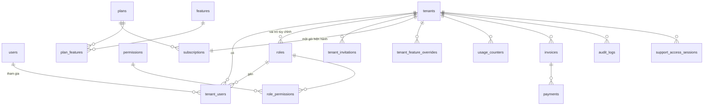
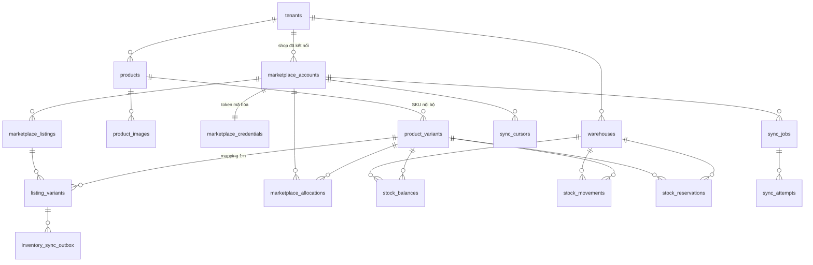
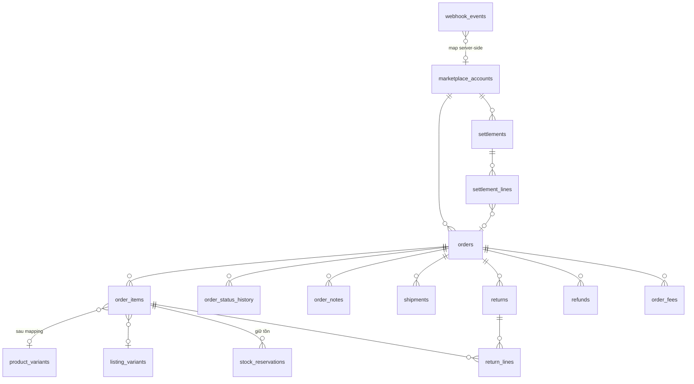
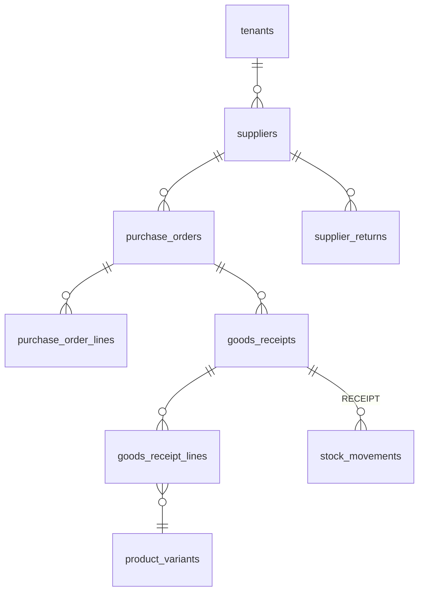

# ERD

> Phase 0 (2026-10-31). Cột đầy đủ xem [DATABASE.md](DATABASE.md). Sơ đồ viết bằng Mermaid (GitHub hiển thị trực tiếp).

## 1. Tenancy, Access, Billing

## 2. Catalog, Marketplace, Inventory

## 3. Orders, Fulfillment, Returns, Finance

## 4. Purchasing

## 5. Quan hệ then chốt cần nhớ

- **Một `product_variant` (SKU nội bộ) ↔ nhiều `listing_variants`** (nhiều shop, nhiều sàn). Mapping chỉ bằng `external_sku_id` / `seller_sku` khớp chính xác hoặc người dùng xác nhận; gợi ý theo tên chỉ là `suggested`.
- **`stock_balances` là số dư, `stock_movements` là sự thật.** Số dư luôn tái tạo được bằng tổng movements.
- **`marketplace_accounts(marketplace, external_shop_id)` unique toàn hệ thống** ⇒ webhook map ra đúng một tenant.
